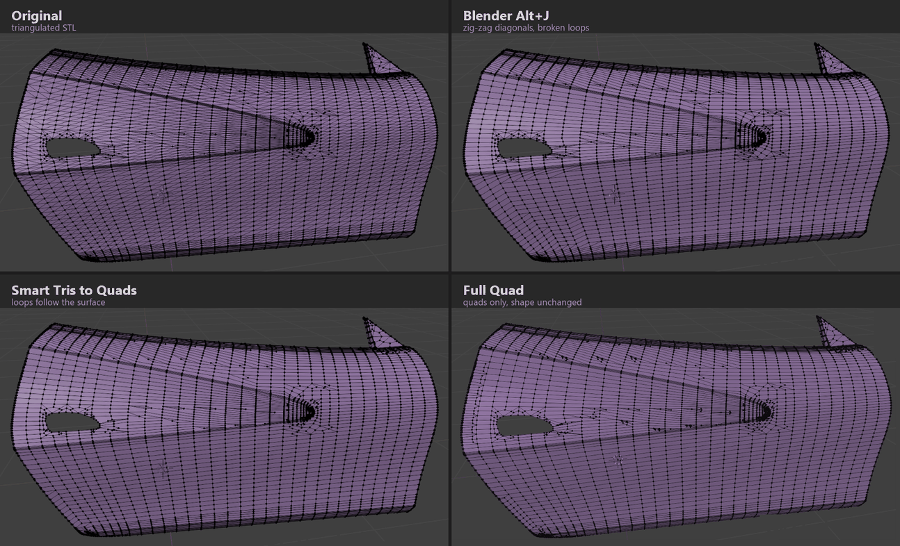
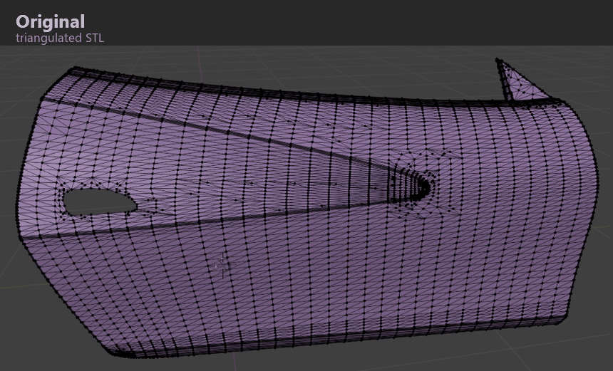
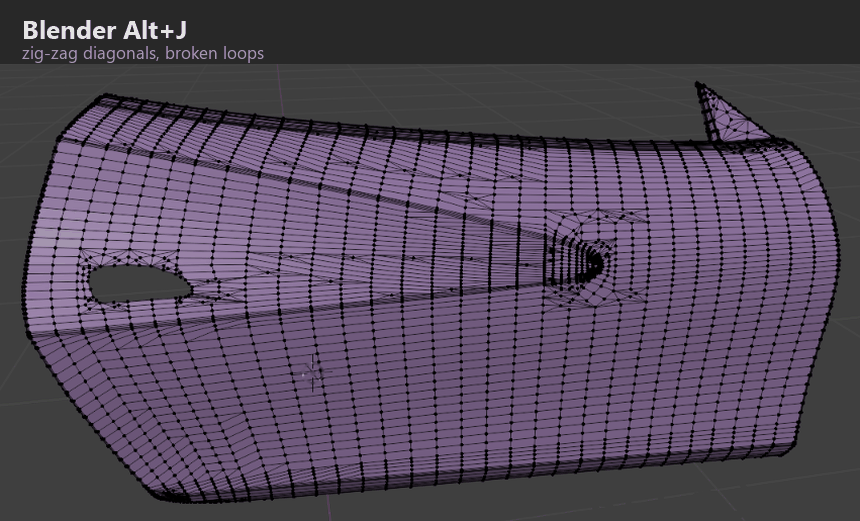
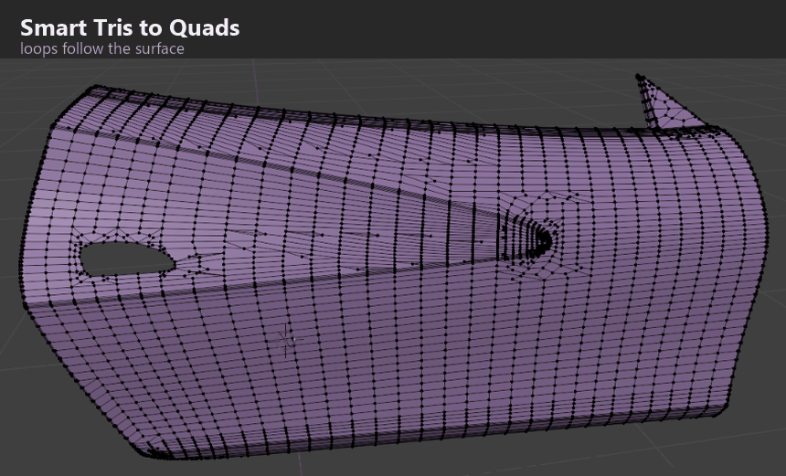
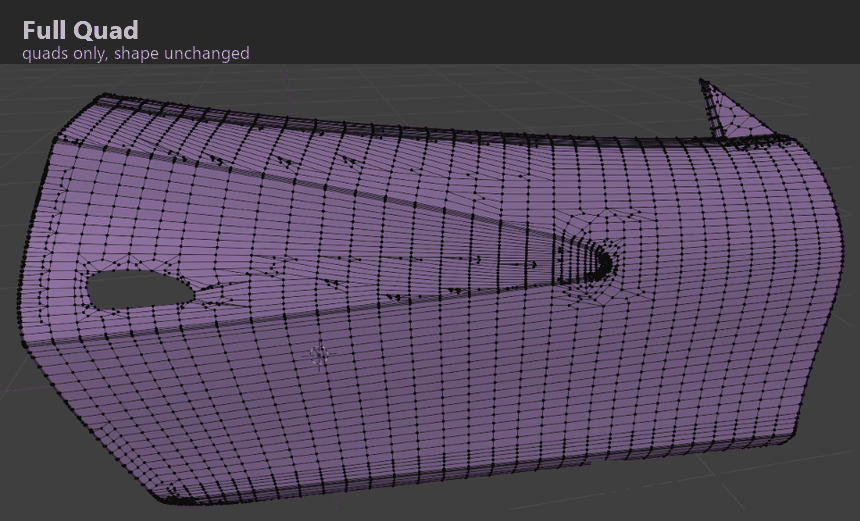

# Smart Tris to Quads

A smarter **Alt+J** for triangulated meshes (STL from CAD or other tools), as a Blender add-on.



- **Smart Tris to Quads**: pairs triangles along the real grid, so edge loops follow the surface
  instead of zig-zagging. It also carries face rows straight across dense bevels, and redraws flat
  CAD faces made of huge sliver triangles.
- **Full Quad (adds points)**: finishes with quads only. It adds points on edges and inside faces.
  Original vertices never move, and new points sit exactly on the original surface.

Works in Blender 3.6 to 5.x (tested in 4.2 and 5.2).

<details>
<summary><b>Bigger pictures</b> (car door from a CAD STL export)</summary>

**Original**: the triangulated STL.


**Blender Alt+J**: diagonals zig-zag, edge loops break up.


**Smart Tris to Quads**: edge loops follow the surface and run straight through the bevels.


**Full Quad**: only quads remain; the original vertices did not move.


</details>

## Install

1. Download `smart_tris_to_quads-<version>.zip` from the
   [latest release](https://github.com/Pavelbotsu/smart-tris-to-quads/releases/latest).
   Don't unzip it.
2. Install it:
   - **Blender 4.2 and newer**: drag the zip into the Blender window, or
     Edit > Preferences > Get Extensions > (v) > **Install from Disk**.
   - **Blender 3.6 to 4.1**: Edit > Preferences > Add-ons > **Install...**, pick the zip, then tick
     the checkbox to enable it.
3. To update, install the new zip the same way. It replaces the old version.

## Using it

- Sidebar (N) > **Tris2Quads** tab: **Smart Tris to Quads** and **Full Quad (adds points)**.
- Edit Mode: Face menu (Ctrl+F), or **Shift+Alt+J**. The preferences have an option to put it on Alt+J.
- Object Mode: converts every selected mesh object. Edit Mode: only the selected faces.
- After running, press **F9** to change the settings and see the result update live.

## Bugs and ideas

Please open an [issue](https://github.com/Pavelbotsu/smart-tris-to-quads/issues) and attach a
small sample mesh (`.stl` or `.blend`). See [CONTRIBUTING.md](CONTRIBUTING.md).

## License

GPL-3.0-or-later, see [LICENSE](LICENSE). © 2026 Pavlo Botsula.

---

## Development

### Project layout

```
smart_tris_to_quads/        <- the add-on (this folder is what Blender installs)
  __init__.py               bl_info, register(), reload support
  blender_manifest.toml     extension info for Blender 4.2+ (version must match bl_info)
  engine.py                 triangle pairing (the core "tris -> quads")
  bevels.py                 "Continue Rows Through Bevels"
  flat.py                   "Rebuild Flat CAD Faces"
  fullquad.py               "Full Quad": parity pairing, quad splitting, relaxing
  ui.py                     operator + its settings (F9 panel), sidebar panel, menu, shortcut
tools/build.py              makes dist/smart_tris_to_quads-<version>.zip
tests/                      test meshes, benchmarks, install test (run outside Blender with `bpy`)
.github/                    release workflow, issue/PR templates
.vscode/                    editor settings, recommended extensions, build/test tasks
```

Where to change things:
- **Default values / new options**: `ui.py`, the properties at the top of `MESH_OT_grid_tris_to_quads`.
  Pass a new option through `_run()` into `grid_tris_to_quads()` in `engine.py`.
- **How triangles get paired**: `engine.py`. The scoring is in the candidate loop (`w_shape`,
  `w_diag`, `w_plan`) and `grow_score()`.
- **Bevels**: `bevels.py` (`rebuild_strips`, `_rebuild_band`).
- **Full Quad**: `fullquad.py` (`_pair_odd_faces`, `_plan_face`, `_relax`).
- **Version number**: `bl_info["version"]` in `__init__.py` **and** `version` in
  `blender_manifest.toml`.

### Setting up VS Code

1. Open this folder in VS Code (File > Open Folder).
2. Install the recommended extensions when VS Code asks (Python, Pylance, Blender Development).
3. Optional, for autocomplete on `bpy`/`bmesh`/`mathutils`:
   `pip install -r requirements-dev.txt`

### Edit -> try in Blender

**Option A: Blender Development extension (live reload)**
1. `Ctrl+Shift+P` > **Blender: Start**, then pick your `blender.exe` the first time.
2. Blender opens with the add-on loaded from this folder.
3. Edit a file and save. The add-on reloads automatically (or run **Blender: Reload Addons**).
   `print()` output shows in the VS Code terminal.

**Option B: install the zip**
1. `Ctrl+Shift+B` (task "Build add-on zip") creates `dist/smart_tris_to_quads-<version>.zip`.
2. Install it as described in [Install](#install).
3. After later edits: rebuild, then install the new zip over the old one (or F3 > "Reload Scripts").

> If you installed the old single file `smart_tris_to_quads.py`, **remove it first** in
> Preferences > Add-ons. Otherwise Blender finds two add-ons with the same name.

### Tests (optional, outside Blender)

These need Blender's Python module (`pip install bpy`, matching Python version), plus numpy and
matplotlib for the pictures.

```
python tools/build.py && python tests/test_addon_install.py   # install + run, prints PASS/FAIL
cd tests && python test_full.py                               # Full Quad on all test meshes
cd tests && python regress.py                                 # compare with stock Alt+J
```

The install test also runs inside a real Blender:
`blender -b --factory-startup --python tests/test_addon_install.py`

### Making a release

1. Bump the version in `bl_info` (`__init__.py`) **and** `blender_manifest.toml`.
2. Add a `## [x.y.z] - YYYY-MM-DD` section at the top of `CHANGELOG.md`.
3. Build and test: `python tools/build.py`, then install the zip in a clean Blender
   (oldest and newest supported). Optional check for Blender 4.2+:
   `blender --command extension validate dist/smart_tris_to_quads-<version>.zip`
4. Commit, then tag and push:
   ```
   git tag v<version>
   git push origin master v<version>
   ```
   GitHub Actions builds the zip and publishes a Release with the CHANGELOG section as its text.
